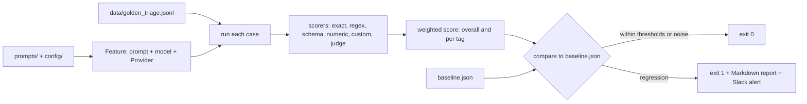

# LLM Regression Guard

A CI-style check that re-tests an LLM-powered feature against a golden dataset whenever its prompt or model config changes, flags real quality regressions (and ignores noise), and alerts the team on Slack.

[](https://github.com/Shamiur777/llm-regression-guard/actions)

All data in this repo is synthetic and fictional. The model is **simulated**: no API key was used and no real model was called (see "Limits").

## The problem
Prompts and model versions change often, and a change that fixes one case can quietly break ten others. Eyeballing a few outputs does not catch that. Re-running a fixed set of cases and comparing against the last known-good result does, but naive comparison cries wolf: LLM outputs are noisy, so a handful of cases flip every run. A guard that alarms on noise gets ignored. This project compares runs case by case and only alarms when the change is bigger than noise.

## How it works



- `regression_guard/dataset.py`: JSONL loader. Each line has `id`, `input`, `expected` and/or `criteria`, `tags`, `weight`. Validation errors name the line.
- `regression_guard/feature.py`, `providers.py`: a `Feature` is prompt file(s) + model config + a `Provider` (`complete(system, user) -> str`). Providers: `MockProvider` (deterministic, simulated), `ScriptedProvider` (canned replies for tests), `AnthropicProvider` (optional, lazy import, `ANTHROPIC_API_KEY`, model from `REGRESSION_GUARD_MODEL`, default `claude-sonnet-5-5`).
- `regression_guard/scorers.py`: exact match, contains, regex, JSON-schema validity (small built-in subset, no dependency), numeric tolerance, custom Python callable (`module:function`), optional LLM-as-judge through a Provider. A case's score is the fraction of its criteria passed; it passes only if all pass.
- `regression_guard/runner.py`: weighted aggregation overall and per tag; `baseline.json` stores metrics plus every case's input, expected, output and result.
- `regression_guard/detect.py`: the regression rules (below).
- `regression_guard/report.py`, `slack.py`: Markdown report with the worst flips; Slack incoming-webhook blocks sent with `urllib`.

### Regression rules (`config/rules.json`)
| Rule | Default | Fires when |
|---|---|---|
| `max_overall_drop` | 0.05 | weighted overall score fell by at least 5 points |
| `max_tag_drop` | 0.10 | a tag (with at least `min_tag_cases` = 5 cases) fell by at least 10 points |
| `max_flips` | 5 | more than 5 cases went pass to fail |
| `stat_guard` | on | every rule above additionally needs an exact one-sided McNemar test on paired pass/fail outcomes to reject "pure noise" (`alpha` 0.05 overall and for flips, `tag_alpha` 0.10 per tag) |

Improvements (score gains, fail-to-pass flips) are reported but never alert. Exit codes: `0` ok, `1` regression, `2` error (missing baseline, bad dataset, bad config).

### The example feature
A support-ticket triage and reply drafter (`prompts/triage.txt`, prompt v1): it returns JSON with `category`, `priority`, `sla_hours` and a short `reply`. `prompts/examples/triage_v2_degraded.txt` is a deliberately worse rewrite (shorter keyword lists, no "JSON only" instruction, a category dropped). The golden set has 81 cases, 6 categories plus "other", with priority variants and 6 hand-written hard cases; high-priority cases have weight 2. Scorers used: JSON schema, exact match on two fields, regex on the reply, numeric tolerance on `sla_hours` (a subset), and a custom callable. The `tools/generate_golden.py` script reproduces the file. The `easy`/`hard` tags are my own a-priori labels, and the simulated v1 gets a few "easy" cases wrong where a keyword is missing.

**Simulation, not a model:** `regression_guard/examples/triage.py` is a keyword-driven function that reads the keyword lists and instructions out of the prompt text it receives. Changing the prompt therefore genuinely changes outputs, which is what lets the demo show a regression offline. A `noise` setting randomly corrupts a category with a seeded probability to imitate sampling nondeterminism. None of this says anything about how a real model would behave.

## Results (all simulated)

Reproduce with the commands shown. Suite: 51 tests passing (`python -m pytest -q`).

**Demo** (`python -m regression_guard demo`), 81 cases, mock provider with 5% seeded noise:

| Step | Overall score | Pass rate | Paired flips (worse / better) | Outcome |
|---|---|---|---|---|
| Baseline, prompt v1 | 92.9% | 82.1% | n/a | stored |
| v1 re-run, different noise seed | +1.4 points | n/a | 3 / 5, p=0.855 | no alert |
| v2 degraded prompt | 70.9% (-22.0) | 31.6% | 38 / 0, p<0.0001 | regression, exit 1, report, Slack payload (dry run) |

**False-alarm check** (`python -m regression_guard.false_alarm --runs 200`, also with `--noise 0.10`): the baseline is one seeded run; then the unchanged prompt is re-run with 200 different noise seeds and compared with the default rules.

| Simulated noise | Guard ON: false alarms | Guard OFF: false alarms | Degraded v2 caught (guard ON) |
|---|---|---|---|
| 5% | 0 / 200 | 20 / 200 | 200 / 200 |
| 10% | 1 / 200 | 125 / 200 | 200 / 200 |

"Guard OFF" applies the same thresholds without the McNemar requirement. It shows why the guard exists: raw thresholds alarm on noise. These numbers describe the detector on a simulated noise model with a very large, obvious regression. How it would handle a subtle regression, a different noise level, or a real model is not measured yet.

## Run it

Windows (PowerShell or cmd), from the project folder:

```bash
python -m venv .venv
.venv\Scripts\python -m pip install -r requirements.txt
.venv\Scripts\python -m pytest -q                       # 51 tests, offline, no API key
.venv\Scripts\python -m regression_guard demo           # v1 passes, v2 is caught (simulated)
.venv\Scripts\python -m regression_guard baseline       # write baseline.json from the current prompt
.venv\Scripts\python -m regression_guard run            # just print metrics
.venv\Scripts\python -m regression_guard check --report report.md   # exit 1 on regression
.venv\Scripts\python -m regression_guard check --prompt prompts/examples/triage_v2_degraded.txt --dry-run
.venv\Scripts\python -m regression_guard.false_alarm --runs 200
```

Slack: set `SLACK_WEBHOOK_URL` (an incoming-webhook URL from your own Slack workspace) in the environment; `check` posts only when a regression is found. `--dry-run` prints the JSON payload instead. The URL is never stored in the repo. Slack sending is tested against a local HTTP server that captures the POST, not against Slack itself.

Live mode (untested): set `"provider": {"type": "anthropic"}` in `config/feature.json`, `pip install anthropic`, set `ANTHROPIC_API_KEY`. The provider is covered by a test using an injected fake client only; I have not run it against the real API. With a real model, regenerate `baseline.json` and expect to tune the rule thresholds.

### GitHub Actions
- `.github/workflows/tests.yml`: unit tests on push and pull request.
- `.github/workflows/regression-check.yml`: on pull requests touching `prompts/**` or `config/**`, runs `check` against the committed `baseline.json`, appends the report to the job summary, sends the Slack alert if the `SLACK_WEBHOOK_URL` repository secret exists, and fails the job on regression.

**Both workflows are included but have not run on GitHub yet; they run on first push.** After an intended prompt improvement, re-run `baseline` and commit the new `baseline.json`.

## Design decisions
- **Paired comparison, not two averages.** Both runs score the same cases, so the McNemar test on discordant cases uses the pairing and is far more sensitive than comparing two pass rates.
- **The statistical guard gates every rule**, including the flip cap, because a cap on flips alone is the classic source of noise alarms.
- **Scores for thresholds, pass/fail for the test.** Weighted fractional scores drive the size rules; the unweighted pass/fail outcomes drive the significance test (weights are not used there).
- **Strict where it matters:** field scorers tolerate chatter around JSON, but the `json_schema` scorer requires the whole output to be JSON, so a "helpful preamble" counts as a failure.
- **Provider outage = failed cases**, loudly, rather than a crashed run that CI might skip.
- **Standard library only** apart from pytest.

## Limits and next steps
- Toy scale: 81 synthetic cases, one example feature, a keyword-based simulator. Per-tag tests over 5 to 14 cases have little power.
- Nothing here measures real model quality. The live provider path and the real Slack webhook are untested.
- The check re-runs each case once. With a real model, sampling several times per case and judging stability would be better.
- McNemar here ignores case weights and assumes the golden set is a fair sample of production traffic.
- Next: repeat-sampling per case, a mild-regression sensitivity sweep, baseline refresh workflow on merge, a judge-based scorer exercised with a real judge model.
